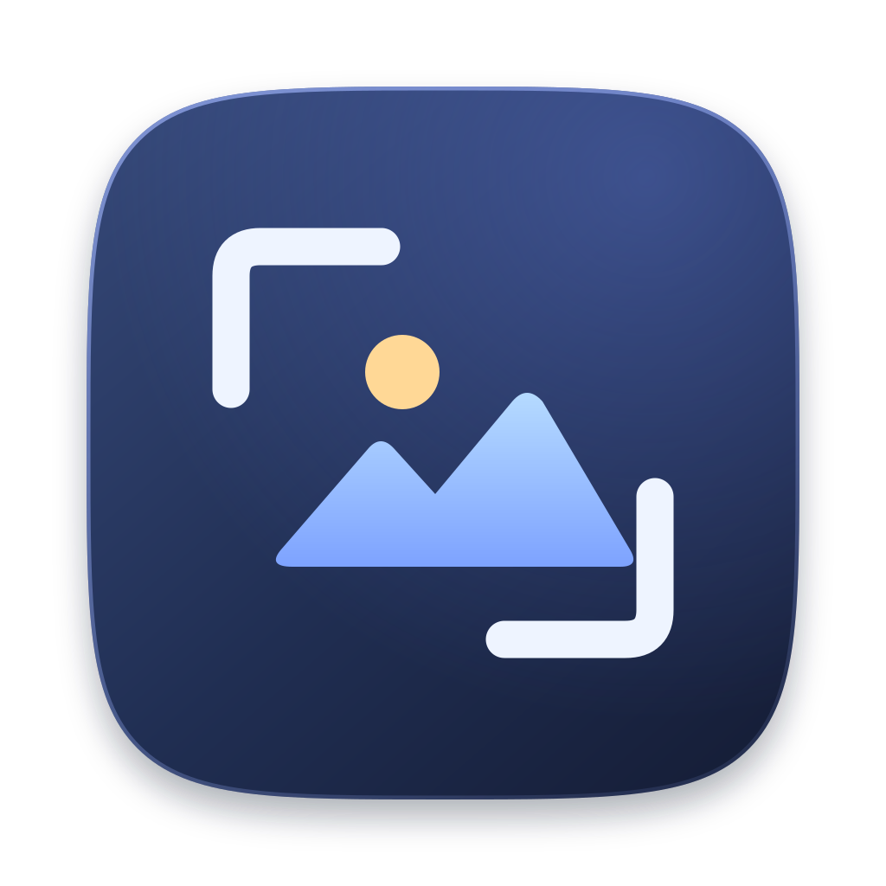

# ImageEdit



ImageEdit is a lightweight desktop image editor in development. It uses Rust
and [GPUI](https://gpui.rs/) with a GIMP-inspired workspace and native macOS
menus. The current milestone supports single-layer image editing.

## Try it on macOS

Install a recent Rust toolchain with Cargo and select an Xcode installation.
Clone the repository, then run these commands from its root.

```sh
./scripts/bundle-macos.sh
open dist/ImageEdit.app
```

The script builds an optimized, ad hoc signed app with the ImageEdit icon and
Finder file associations. Use the bundle to check image loading performance
and Finder integration. Run `cargo run --locked` for a debug build.

## Editing and saving

- **File → New Image** accepts pixel dimensions and creates a transparent
  canvas or fills it with the background swatch.
- **File → Open** accepts ImageEdit projects, PNG, JPEG, and WebP. You can
  also drop files onto the canvas or use Finder’s **Open With** menu.
  Reopening the same file focuses its existing tab.
- **Save** updates the current file. New canvases default to an
  `.imageedit` project. **Save As** adopts the new filename and uses
  its extension to choose the format. **Save Project As** suggests
  `.imageedit` when converting an opened image to a project.
- Projects preserve the canvas dimensions and the layer stack: each layer's
  order, name, position, visibility, opacity, and lossless pixels with
  transparency. ImageEdit writes version 2 projects and still opens version 1
  projects. PNG and lossless WebP preserve transparency. JPEG saves against
  white. The working pixel format is 8-bit RGBA.
- Drag a rectangle with **Crop** and press Return to apply it or Escape to
  cancel. **Bucket Fill** uses the foreground color on connected pixels with
  matching RGBA values. **Color Picker** samples the image at full resolution.
  Click either color swatch for the hue and saturation wheel, brightness
  slider, and hex input. The last 12 distinct colors set or sampled in the
  workspace are available in Recent Colors. Click the swap icon between the
  swatches or press X to flip them. Press D to restore black foreground and
  white background.
- Use the Zoom tool, View menu, or status bar to zoom. Control-scroll zooms
  around the pointer. Scroll or use a middle-button drag to pan a zoomed
  image. Pan is also available from the toolbox for left-button dragging.
  The cursor shows the selected tool beside the canvas crosshair.

| Action | macOS shortcut |
| --- | --- |
| New / Open | ⌘N / ⌘O |
| Save / Save As / Save Project As | ⌘S / ⌘⇧S / ⌘⌥S |
| Close Tab | ⌘W |
| Next / Previous Tab | Control-Tab / Control-Shift-Tab |
| Crop / Bucket Fill / Color Picker | Shift+C / Shift+B / O |
| Foreground / Background color dialog | ⌥O / ⌥⇧O |
| Swap / Reset colors | X / D |
| Zoom tool / Zoom In / Zoom Out | Z / + / − |
| Actual pixels / Fit | 1 / ⌘⇧J |

Menus and the toolbox still show planned features such as multiple layers,
text, color adjustments, filters, and undo. Commands without handlers appear
disabled. Windows is a future target.

## Development

```sh
cargo fmt --check
cargo clippy --locked -- -D warnings
cargo test --locked
```

See [AGENTS.md](AGENTS.md) for the architecture, current scope, and macOS
smoke checks.
