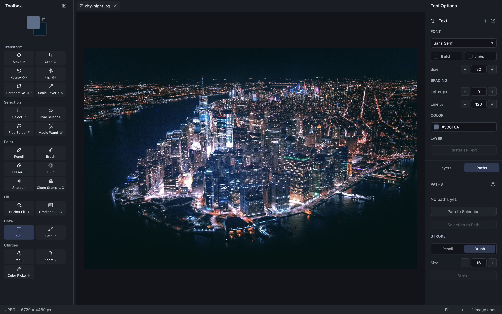

# Lime

**Lite Image Editor** for macOS and Windows. Layered editing, native menus with
tool and command icons, and a workspace that keeps the canvas in focus.

## Features

- **Layers** — move, align, reorder, merge, and adjust opacity.
  Alpha lock preserves transparency while recoloring; position lock protects
  layers from manual moves and transforms.
  The opacity slider keeps your chosen value while the canvas updates; each drag
  is one undo step. You can keep dragging outside the slider and release at the
  desired position. Pending text commits before the opacity change.
- **Selections and transforms** — rectangle, oval, freehand, and magic wand;
  crop, resize, rotate, flip, and perspective.
  Grow/Shrink retain feathered edges. The wand can sample the visible layers.
  Rectangle and oval selections have exact position/size controls and optional
  smooth curved edges. Selections and Crop support fixed aspect ratios.
  Scale Layer has editable dimensions, aspect locking, and resampling choices;
  Rotate accepts typed angles.
- **Painting and retouching** — pencil, brush, eraser, clone stamp, gradients,
  and fills.
  Paint and retouch tools remember separate brush settings for the session.
  Opacity limits each stroke; optional Buildup and Flow control gradual coverage.
- **Text and paths** — editable text, searchable fonts, bold and italic,
  plus paths and strokes.
- **Color and effects** — brightness, contrast, hue, saturation, levels,
  curves, blur, sharpen, and shadows.
  Dialog previews show the canvas composition, with Before/After and Reset.

## Download

**Lime 1.0.1** · [Release notes](https://github.com/eimg/lime/releases/tag/v1.0.1)

| Platform | Download | Install |
| --- | --- | --- |
| macOS (Apple silicon) | [DMG](https://github.com/eimg/lime/releases/download/v1.0.1/Lime-1.0.1.dmg) | Open the disk image and drag Lime to Applications. |
| Windows x64 | [EXE](https://github.com/eimg/lime/releases/download/v1.0.1/Lime-1.0.1-windows-x64.exe) | Download and run. No installer. |

Windows needs Windows 10 or later, DirectX, and the Microsoft Visual C++
2015–2022 x64 runtime if it is not already installed. Windows builds are unsigned;
macOS builds are ad hoc signed and not notarized.

The macOS disk image opens an installation window with Lime on the left and
Applications on the right. Drag Lime along the arrow into Applications, then
open the copied app from there. Eject the disk image after installation.

Lime quietly checks for a new stable release about once a day. When one is
available, a badge appears at the right of the status bar. Click it for the
changelog and a direct download for your platform. **Check for Updates…** is
also available in the Lime menu on macOS and the Help menu on Windows.
Downloads open in your browser; you choose when to download and install them.
Lime never installs updates automatically. Offline checks stay quiet; a manual
check offers a retry and a link to the releases page if it cannot connect.

## Getting started

Open a PNG, JPEG, WebP, or PDF, drop one into the workspace, or create a new image.
PDF files open an import dialog: choose all pages or a range, set the resolution
in DPI, and add the pages as layers or as separate images. **Page background**
can be White (the default) or Transparent. Transparent keeps unpainted page
areas clear and preserves PDF opacity; white shapes painted in the PDF stay
white. For a new layered image, **Canvas size** offers First Page or **Fit All
Pages**, which fits the greatest selected width and height. Every page stays at
its rendered size and is centered. The dialog shows the canvas size and warns
when selected pages extend outside it; those layer pixels are retained.
Separate images keep each page's own size, and Open as Layers keeps the existing
canvas size. Successful imports remember DPI and page background for the session;
new-document imports also remember Layers/Images and canvas sizing. Canceling
or failing an import leaves those defaults unchanged. Page ranges reset for each
file. A PDF import becomes a new unsaved Lime project; PDF is not a save or export format. Encrypted PDFs are
not supported. Open as Layers accepts one PDF at a time. Multiple PDFs opened
together keep their import dialogs queued. Pages are rasterized at the chosen
DPI; PDF text and vector objects do not become editable text or paths.
Reading, inspection, rendering, and image preparation show progress. Use Cancel
or Escape to discard the current import. Cancellation waits for a running page,
parser call, or image-preparation step to finish; no partial result is added.
Canceling one file leaves later queued files available to open.

Each PDF is inspected when its turn opens, and its bytes are retained for that
import. Replacing or deleting the original file afterward does not change the
pages being imported. Open as Layers checks the whole selected range against
the destination's remaining layer and memory capacity before rendering. If it
does not fit, reduce the page range or DPI; a successful import adds all selected
pages in one undo step.
Pick a tool on the left and adjust its settings on the right. Hover the **?**
beside a tool name for gestures and shortcuts.

Save as **`.lime`** to keep layers, editable text, and paths. Use **Export** for
a flattened PNG, JPEG, or WebP copy. Apply or cancel an active preview before saving.
Finish or cancel an unfinished free selection first. If an image gains layers
while the save dialog is open, save it as a `.lime` project or export a copy.
Smooth scaling keeps the colors of nearly transparent pixels intact; show a
hidden layer before dragging its Scale Layer frame.
Reduced previews and layer thumbnails also preserve transparent edge colors.
Save and Undo shortcuts finish an active numeric selection edit first.

With **Scale Layer** (Shift+S), type Width or Height to preview a resize.
**Size anchor** chooses which of nine points stays fixed during numeric resizing;
it starts at Center. Choosing an anchor alone does not resize the layer. Border
and corner drags keep their opposite edge or corner, independent of this choice.
Return or clicking outside commits one undo step; Escape or empty text restores
the original size. Aspect locking starts on; Shift temporarily reverses the lock
while dragging. Choose Nearest, Bilinear, or Bicubic for the committed result.
**Fit Layer to Canvas** in these options or the Layer menu scales the whole layer
proportionally to fit inside the canvas and centers it. This works even when its
resize handles are off-screen. It uses the chosen resampling, may enlarge smaller
layers, and commits one undo step. The layer must be visible, rasterized, and
position-unlocked. The canvas and selection stay unchanged. **Layer to Image
Size** is a separate command that crops/pads the layer at its existing pixel
positions; it does not proportionally scale the image.

In **Rotate**, enter an angle in degrees (including negative values and tenths),
then use Apply after finishing the numeric edit. **Pivot** offers nine anchors
on the original layer, signed canvas X/Y coordinates in tenths of an image pixel,
and a draggable circular crosshair. Drag elsewhere to rotate around that point;
Shift snaps the angle to 15-degree steps. Changing the pivot recalculates the
original layer at the current angle. Center restores the existing centered
rotation, including lossless pixel placement at quarter turns. Fractional custom
pivots use the selected resampling when their rotated pixel grid is fractional.
Pivot choices alone at zero angle do not edit pixels or add history. Empty
numeric text or Escape restores that field; Escape on the canvas cancels the
whole preview. A new rotation session starts centered. Applying a changed result
creates one undo step while the canvas and selection keep their coordinates.
**Perspective** offers a corner selector and signed canvas X/Y coordinates in
tenths of a pixel. Dragging a grip selects it; its larger accented outline keeps
a dark rim for contrast. Reset Corner restores that point to its original layer
corner, and Reset All restores the original rectangle. Both change the preview
only. Empty text or Escape restores the active field. Crossed, concave, or
oversized results show an error and cannot be applied until corrected; Apply
commits one undo step and leaves the selection in canvas coordinates.

**Sample All Layers** on the Magic Wand samples the visible composite and can
select beyond the active layer.

**Rectangle Select** and **Oval Select** accept X/Y and Width/Height for an
editable geometric selection. Return or leaving the field commits one selection
undo step; Escape or empty text restores it. Selection changes keep the image's
saved state. **Antialias edges** optionally smooths oval/circle and rounded
rectangle edges; it starts off for hard pixel selections. Toggling it also
updates the current editable curve. Combined, clipped, feathered, and wand masks
keep their existing coverage when this setting changes.

**Free Select** has its own **Antialias edges** option for new freehand/polygon
selections. It also starts off; enabling it preserves fractional edge coverage
when the outline closes, without blurring aligned pixel edges.

Rectangle Select, Oval Select, Free Select, and Magic Wand offer **Feather new
selections**, with a shared radius of 0–128 image pixels (initially 8). Feathering
starts off. These settings affect new selections when their gesture finishes;
they leave an existing selection unchanged. A radius of zero skips feathering.
Feathering happens before add/subtract/intersect, so repeated additions do not
soften the old selection again. Use **Select → Feather…** to soften the current
selection. Feathered selections are coverage masks; their numeric geometric
position/size controls are unavailable, as with other mask selections.

Feathering treats space outside the canvas as unselected. A selection touching
the border softens there too, including Select All. Coverage remains inside the
canvas. Hard-edge and unfeathered workflows keep their existing behavior.

Selection and **Crop** offer Free, 1:1, 4:3, 16:9, and Image aspect ratios.
Choose a fixed preset and edit Ratio W/H for a custom ratio. It constrains the
next creation drag, handle resize, or Width/Height edit; choosing a ratio alone
leaves the current box in place. Circle takes priority over the oval ratio.
Dimensions round to the nearest image pixel and stay within the available
canvas space when resizing or typing. A side handle keeps the opposite edge
and centers the other axis; a corner keeps its opposite corner. Fixed-ratio
handles stop at the minimum size when dragged past their opposite edge.

**Move** accepts signed X/Y coordinates with a live preview. Return or leaving
the field commits; Escape or empty text restores the position. Arrow keys move
one image pixel, or ten with Shift, regardless of zoom. Releasing an arrow commits
one undo step for that key sequence. Hold Shift while dragging **Rotate** to snap
to 15-degree angles.

Each Layers row has **Lock Alpha** and **Lock Position** buttons beside its
visibility button. Accent-colored closed locks are on; dimmed open locks are off. Like the
visibility control, these icons have no persistent button background. Hover for
their name and effect. These controls affect that row's layer without changing the
active layer. The Layer menu toggles locks for the active layer.
Alpha lock preserves each pixel's transparency through painting,
clone strokes, fills, gradients, adjustments, and filters. Fully transparent
pixels keep their stored colors. Eraser, Cut, and Clear cannot remove pixels
while alpha is locked. Rasterize editable text before enabling alpha lock.

Position lock blocks manual layer moves, numeric positions, arrow nudges,
alignment, scaling, rotation, flipping, perspective, and layer fit/crop commands.
Image-wide crop, scale, rotation, flip, and canvas resizing still transform the
document together. Text remains editable at its original anchor; its bitmap can
resize as text or styles change. Opacity, visibility, layer order, and deletion
remain available. Unlock participating layers before Merge Down. Locks undo/redo
and are retained when a layer is duplicated.

Save locked layers in **`.lime`** projects. Lock-bearing projects use format
version 8 and require this build or newer. Export still makes flattened raster
copies; ordinary raster Save cannot discard the lock settings.

**Clone Stamp** starts with Aligned enabled, preserving the source offset across
strokes. Turn it off to start each stroke at the chosen source. **Sample All
Layers** reads the visible canvas, including other layers' opacity and rendered
text; otherwise the active raster layer supplies the samples. With merged
sampling you can Alt-click a source outside the destination layer's bounds.
The destination is still the active visible raster layer, inside its existing
bounds and the current selection. Each stroke samples the pixels as they looked
when it started, so its own paint cannot feed back into its source.

**Show Source** starts on and displays a blue dashed brush ring and crosshair at
the sampled source position. It follows aligned movement, follows the source
during an unaligned stroke, and resets to the chosen point between unaligned
strokes. The indicator tracks zoom/pan and hides outside the sampled image.
Alt still shows the source-picking cursor. Alt-click to set a source again after
changing sampling, tabs/layers, or layer/canvas geometry. Sampling and alignment
cannot change during an active stroke. These settings are independent of the
Wand and Bucket Fill sample settings.

Wand and connected Fill treat fully transparent pixels as the same color even
when their stored RGB differs; other alpha and tolerance comparisons stay in
effect. Each tool remembers its own **Tolerance** and **Gap radius** for the
session. Tolerance 0 matches exactly. Gap radius starts at 0 (off); increase it
up to 8 image pixels to close small breaks in line-art boundaries before finding
the connected region. Larger radii can also seal narrow passages or small
regions, so start low. The boundary mask is temporary; the artwork is unchanged
until you fill, and original nonmatching pixels are never included in the fill.

Magic Wand has an independent **Antialias edges** option, initially off. It
smooths the contour of each new connected selection with fractional edge coverage;
straight boundaries and uniform interiors stay sharp. Color matching and gap
closure find the connected region first, so smoothing cannot spread the flood
into another region. Sealed gap barriers stay excluded. Small corners and very
thin features can receive partial coverage; turn it off for exact pixel edges.
Changing the option leaves the current selection and history unchanged.

Wand applies new-selection feathering after contour antialiasing, then combines
the new region with the existing selection. Bucket's Selection mode fills the whole
selection and hides the connected-only tolerance, gap, and sampling controls;
their remembered values return when you choose Connected.

For **Pencil**, **Brush**, **Eraser**, and **Clone Stamp**, **Opacity** limits the
effect of one stroke, including where its dabs overlap. Release and paint again
to build up another stroke. **Buildup** starts off; enabling it reveals **Flow**,
the coverage added by each dab toward the opacity limit. Lower flow builds more
gradually as you paint over an area. Spacing controls the distance between dabs;
pointer event frequency does not change the result along the same path. Soft
selection edges and the paint color's alpha still limit coverage.

**Blur** and **Sharpen** show **Strength** instead of Opacity. One stroke blends
toward a local filtered result from the pixels at its start. Overlapping dabs
respect that strength; Buildup and Flow optionally approach it gradually. A new
stroke applies another filter pass. Each paint and retouch tool remembers its
own flow and buildup setting during the session. Path and selection outline
strokes also limit overlapping dabs to their stroke opacity.

Brush, Eraser, Blur, Sharpen, and Clone Stamp offer **Smoothing: Off / Light /
Strong** in a full-width switch group directly below a regular Smoothing label. Off starts selected and
follows the pointer directly. Light steadies small shakes; Strong gives a steadier trace with more lag. When the pointer
stops, the trace catches up within about 64 ms for Light or 128 ms for Strong.
Release reaches the exact pointer endpoint immediately and commits the whole
stroke as one undo step. Escape discards the stroke and its remaining tail.
Each tool remembers its own smoothing choice for the session. Pencil stays
unsmoothed for precise pixel placement. Shift-click straight connectors and
path/selection outline strokes keep their existing geometry. The Clone source
indicator follows the position actually being painted while smoothing is active.

With **Path** (`P`), click to place anchors or drag to pull their handles. Click
the first anchor to close a path. **Alt-click a visible curve** to insert an
anchor while preserving the curve; you can drag the newly inserted point before
releasing. Existing anchors and handles take priority over curve insertion.
Escape cancels an unfinished gesture and ends the current path session.

**Shift-click anchors** to add or remove them from a selection on one path.
Drag any selected anchor to move the group with its handles; clicking an
unselected anchor starts a new selection. Shift-click selects without dragging
or closing the path. **All Anchors** and **Deselect** are in Tool Options, with
a selected count. Every selected anchor has a larger outlined marker. **Corner**
collapses their handles. **Smooth** aligns them while retaining existing lengths,
or creates handles toward neighboring points. Delete/Backspace removes the
selected anchors in one step; with none selected it removes the last anchor.
Clicking the first anchor closes an open path only when it is selected alone.
**Handle Drag** controls future handle edits:
Independent moves only the chosen handle, Aligned keeps the opposite handle's
length while aligning it, and Symmetric mirrors both direction and length.
Independent starts selected; newly drawn handles still start symmetric. These
drag preferences are session settings; the resulting geometry is saved with
the path. Each group drag or shaping/deletion command is one undo step and leaves
raster pixels unchanged. Anchor selection is a session setting and clears when
switching paths/tabs/tools, hiding/deleting its path, or stepping image history.

**Gradient** supports Linear and Radial fills. Drag its line, adjust the endpoints,
then Apply/Return or Cancel/Escape. **Reverse** reverses the colors without moving
the line or changing a radial gradient's center. FG → BG and FG → Clear follow
the foreground/background swatches.

Choose **Custom** to edit up to eight color stops. Select a stop's colored chip,
use **Color…** for the color picker, and type **Opacity %**. Intermediate stops
also offer **Position %** in tenths of a percent. Positions stay between their
neighbors; the two endpoints stay at 0% and 100% and cannot be removed. **Add
Stop** splits the largest gap using its current interpolated color. Switching
back to a swatch mode keeps the custom palette available for later.
Transparent stops blend without letting hidden RGB tint visible edges.

**Save…** names the current colors, shape, and Reverse setting in a personal
library of up to 32 gradients. Names can contain up to 64 characters and must
be unique ignoring case. **Saved gradients** folds away; expand it to select a
named gradient from a scrollable list. Loading uses literal colors, including
opacity, and leaves the swatches and current canvas endpoints in place. Rename
or Delete manages the selected library entry; deleting keeps the current gradient
available to paint or save again. Library entries survive app restarts.

The library lives in `~/Library/Application Support/com.eimg.lime/gradients.json`
on macOS and `%LOCALAPPDATA%\Lime\gradients.json` on Windows. Reads and writes run
in the background, and library changes appear after a successful save. Close/Quit
waits for an active library write before checking unsaved images. A write failure
keeps the window open and reports the error. Unreadable, unsupported-version, or
externally changed libraries are protected from overwrite; use **Reload Library**
after resolving the error. Library data is separate from projects and image undo.
Stop edits and loading a saved gradient update the preview without image history;
Apply commits the selected area in one undo step and honors alpha lock and the
image's color mode. Cancel leaves pixels unchanged.

Adjustment and filter dialogs preview the whole canvas composition, including
layer order, offsets, opacity, and the selection's soft coverage. A checker
shows transparency. **Before** shows the original composition; **After** shows
the chosen effect. Switching views does not change parameters, and Apply always
uses those parameters. **Reset** restores the built-in defaults and
returns to After. Cancel leaves the document unchanged.

Each adjustment and filter remembers its last successfully applied parameters
for this app session, shared across tabs. Canceled, failed, and unchanged edits
leave the previous settings in place. Reset changes the current preview without
overwriting those settings until a changed result is applied.
Drop Shadow also remembers its color; its dialog shows a swatch and offers
**Use Foreground**. Reset uses the current foreground color.

**Filters → Repeat Last Effect** applies the last successful adjustment or
filter to the current layer using the current selection, without a dialog
(Cmd/Ctrl+F). **Reopen Last Effect…** opens its remembered settings with a preview
(Cmd/Ctrl+Shift+F). Repeat creates one undo step when it changes pixels or adds a
shadow layer. Both commands require a visible raster layer and wait for typed
geometry to commit; unfinished canvas previews must be applied or canceled first.
Shadow repeats use the whole layer silhouette, as they do in the dialog, and
check the destination's layer budget before applying.

These fitted previews are limited to 256 pixels on their longest side. Filters
keep nearby off-canvas pixels that can influence the visible result, and shadows
preview beneath their source just as they will be inserted. Small filter radii
can disappear at this reduced scale; Apply always processes the full resolution.
“Updating preview…” identifies a pending slider result while the last preview
remains visible.

Use **View → Toggle Grid** for a dotted grid anchored to image pixels, with
contrasting dots and a default spacing of 16 image pixels.
**View → Toggle Rulers and Guides** shows pixel rulers. With **Move**, drag from
the top ruler for a horizontal guide or from the left ruler for a vertical one.
Drag an existing guide to reposition it; drag back onto a ruler or outside the
canvas workspace to remove it. Escape cancels the drag. Guide edits undo/redo,
and guides follow image crop, resize, scale, rotate, and flip.

Expand Move's **Snapping** section for **Snap to Grid**, **Snap to Guides**, and
grid spacing. It starts collapsed and remembers its open/closed state during the
session. The header shows which snapping options are on; folding it keeps those
settings. Compact Move options leave the remaining sidebar space for Layers.
Both sidebars start at the same width, with the toolbox's resize grip inside its
edge; the toolbox remains resizable.
The snapping controls work independently of
overlay visibility. They snap layer edges and centers within a small screen
distance. Hold Control while dragging to bypass snapping and guide grabs.
Typed positions and arrow nudges remain exact. Grid spacing is in image pixels;
dots thin out at low zoom while snapping keeps the chosen spacing.

Guides are stored in **`.lime`** projects, never flattened exports. A project
containing guides uses format version 7 when its layers are unlocked. Existing
version 6/7 projects still open; unlocked projects without guides retain version
6 on save. Locked projects use version 8, with or without guides.

In **Text**, drag over characters, Shift-click, or use Shift+arrows to select a
range. Copy/Cut use that range; typing and Paste replace it. Selection highlights
follow individual lines. Option+Left/Right and Option+Backspace/Delete on macOS
(Ctrl on Windows) move or delete by word; Shift extends word selections. Normal
arrows and deletion keep combining characters and emoji sequences together.
Font/style controls still affect the entire text layer. Undo/Redo restore typing
and its selection before falling through to document history.

| Action | macOS | Windows |
| --- | --- | --- |
| Open / Save | ⌘O / ⌘S | Ctrl+O / Ctrl+S |
| Undo / Redo | ⌘Z / ⌘⇧Z | Ctrl+Z / Ctrl+Y |
| Copy / Cut / Paste | ⌘C / ⌘X / ⌘V | Ctrl+C / Ctrl+X / Ctrl+V |
| Crop / Move / Text | C / M / T | C / M / T |
| Pan | Hold Space and drag | Hold Space and drag |
| Brush size | [ / ] | [ / ] |
